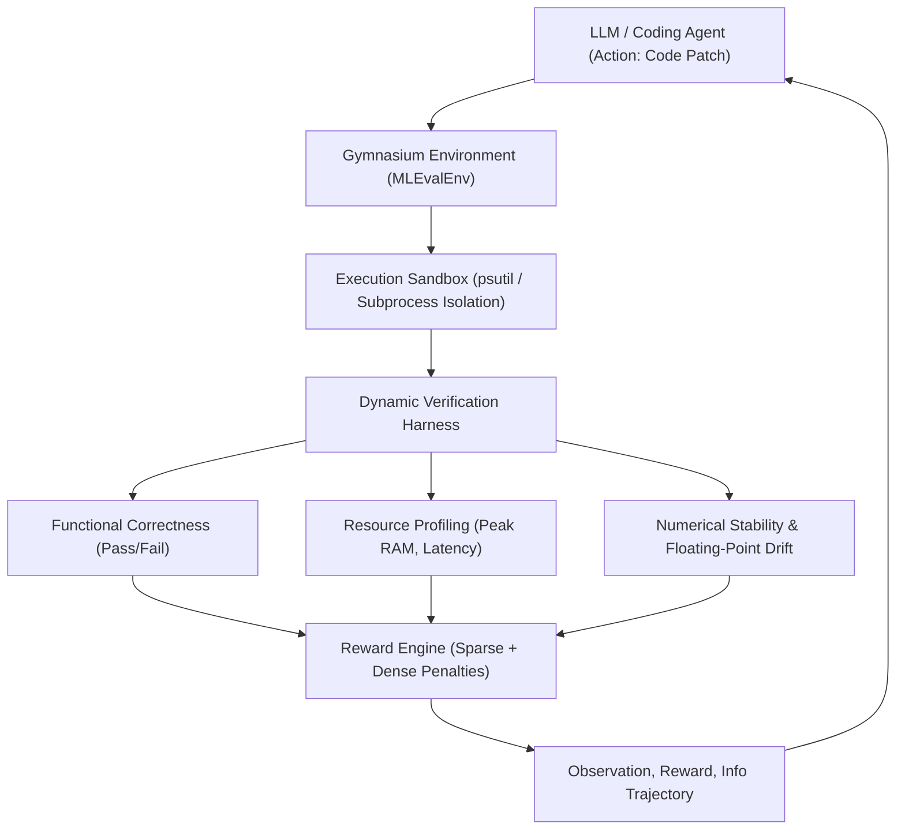

# RL-EvalBench: Frontier RL Environment & Dynamic Code Verification Engine for LLM Agents

<p align="center">
  <b>Frontier Reinforcement Learning Gym Environment & Dynamic Sandboxed Evaluation Engine tailored for training and validating autonomous AI agents on challenging machine learning engineering tasks.</b>
</p>

<p align="center">
  
  
  
  
  
  
</p>

---

## ⚡ Overview

`RL-EvalBench` provides **frontier evaluations and reinforcement learning environments** to train, benchmark, and evaluate autonomous code and ML agents. It bridges the gap between static unit tests and dynamic, performance-critical ML engineering tasks by providing:

1. **Gymnasium-Compliant RL Environment (`rleval.environment.MLEvalEnv`)**: Allows RL algorithms (PPO, GRPO, RLAIF) to train coding agents via standardized `env.reset()` and `env.step(action)` loops.
2. **Dense & Sparse Reward Modeling (`rleval.rewards.RewardEngine`)**: Evaluates functional correctness, penalizes runaway execution latency & memory leaks, and tracks numerical stability / gradient drift.
3. **Sandboxed Subprocess Execution (`rleval.sandbox.ExecutionSandbox`)**: Enforces strict CPU timeouts, memory caps (via `psutil`), and isolated file environments.
4. **Interactive Analytics Dashboard (`dashboard.py`)**: A Streamlit UI to visualize Pass@1 accuracy, execution profiles, and interactive code verification.

---

## 🏗️ System Architecture



---

## 🚀 Quick Start

### 1. Installation
```bash
git clone https://github.com/kvik0802/RL-EvalBench.git
cd RL-EvalBench
pip install -e .
```

### 2. Run Test Suite
```bash
python -m pytest -p no:asyncio tests/
```

### 3. Launch Interactive Streamlit Dashboard
```bash
streamlit run dashboard.py
```

### 4. CLI Benchmark Runner
```bash
python -m rleval.cli --mode oracle --out report.json
```

---

## 📊 Benchmark Metrics

| Metric | Description |
|---|---|
| **Pass@1** | Proportion of tasks where the candidate implementation passes 100% of the unit & integration test suite on the first attempt. |
| **Numerical Error ($\Delta$)** | Maximum absolute deviation against the double-precision reference solution. |
| **Peak Memory (MB)** | Maximum Resident Set Size (RSS) recorded during execution. |
| **RL Reward** | Combined scalar reward (dense test ratio minus latency and memory penalties). |

---

## 📂 Project Structure

```text
├── rleval/
│   ├── environment.py    # Gymnasium RL Environment (MLEvalEnv)
│   ├── sandbox.py        # Sandboxed execution runner with timeout & memory limits
│   ├── rewards.py        # Dense & sparse reward computation engine
│   ├── tasks.py          # Frontier ML & systems engineering tasks
│   ├── evaluator.py      # Benchmark runner and metric synthesizer
│   ├── schema.py         # Pydantic schemas for tasks, results, and rewards
│   └── cli.py            # Command line interface
├── tests/
│   └── test_environment.py # Comprehensive unit and integration test suite
├── dashboard.py          # Streamlit evaluation dashboard & interactive task solver
├── pyproject.toml        # Build configuration and dependencies
└── README.md
```

## 📜 License
MIT License
